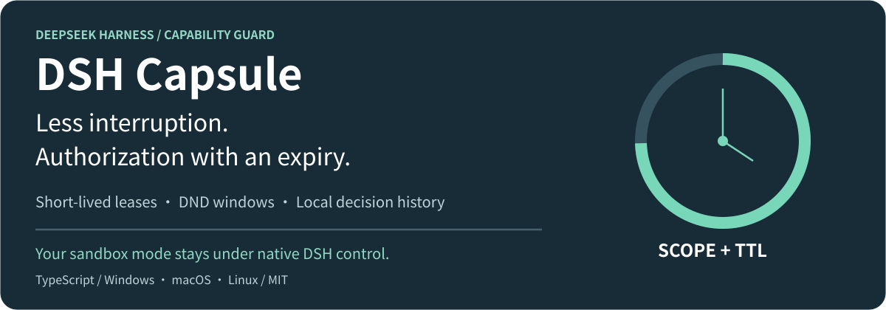
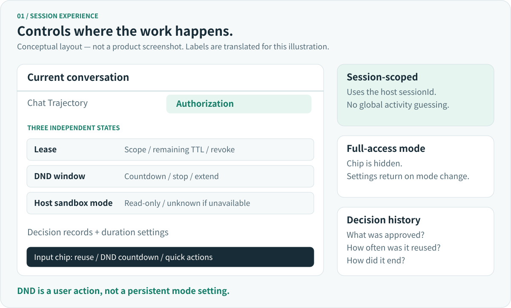
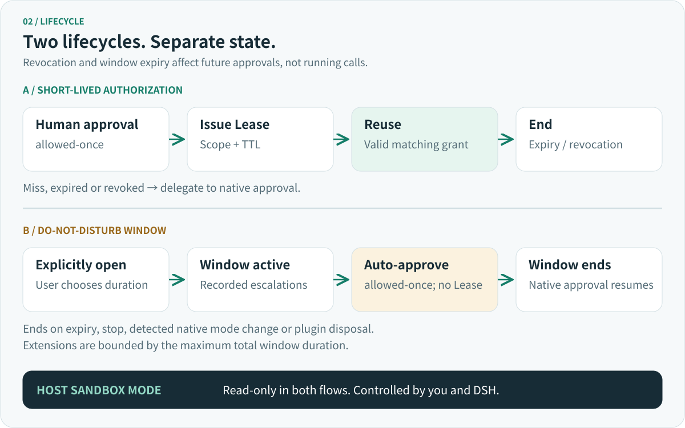
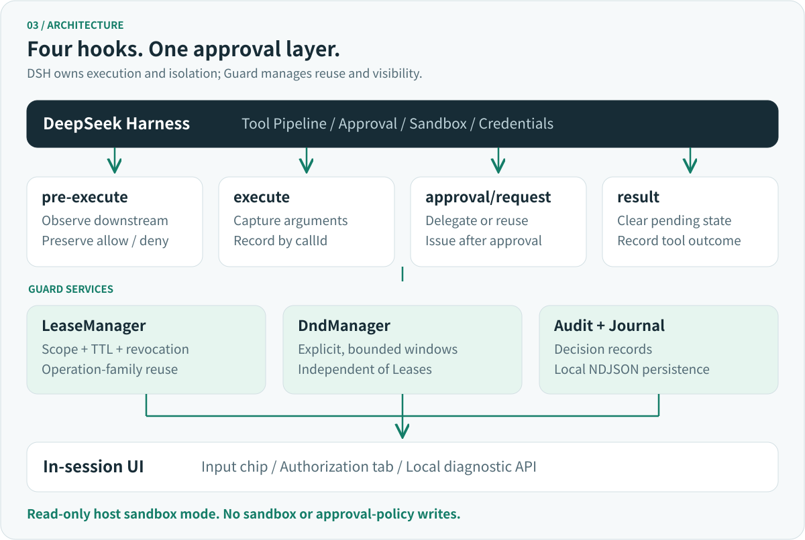

<p align="center">
  
</p>

<p align="center"><a href="README.md">简体中文</a> · <strong>English</strong></p>

<p align="center">
  <a href="https://github.com/whDonline/dsh-capsule/actions/workflows/ci.yml"></a>
  
  
  
  <a href="LICENSE"></a>
</p>

**Turn repeated approvals into authorization that expires, can be revoked, and leaves a record.**

DSH Capsule (Capability Guard) is a pure TypeScript plugin for [DeepSeek Harness](https://github.com/deepseek-ai/deepseek-harness). It adds short-lived authorization reuse to tools that already trigger native DSH approval. You can also explicitly open a do-not-disturb (DND) window to automatically approve eligible sandbox escalation requests in the current session for a limited time. Existing tools need no Guard-specific code changes.

**Guard never changes the session's sandbox mode.** It handles approvals; DSH retains responsibility for sandboxing, approval policy, and credentials.

> [!NOTE]
> **Developer Preview.** CI is configured to build and test on Windows, macOS, and Linux, with real Cordis integration and permission lifecycle tests. Revalidate integration after upgrading DSH; CI is not a promise of live DSH compatibility on every platform.

<p align="center">
  <a href="#quick-start">Quick start</a> · <a href="#everyday-use">Everyday use</a> · <a href="#how-authorization-works">Authorization</a> · <a href="#configuration">Configuration</a> · <a href="#security-boundaries">Security</a> · <a href="#development-and-contributing">Contributing</a>
</p>

## Why use it

An agent working through an edit, test, and inspect loop often requests similar operations repeatedly. Approving every call interrupts your work, while session-wide full access may grant more than you intended. Guard adds a time-limited approval reuse layer:

- **Short-lived authorization:** issue a scoped Lease after human approval, then reuse valid authorization to reduce repeated prompts.
- **DND windows:** explicitly enable automatic approval of recorded sandbox escalation requests in the current session, with an option to stop early.
- **In-session controls:** an input mode chip and an Authorization tab show grants, countdowns, settings, and decision records.
- **Local history:** record approvals, reuse, expiry, and revocation; audit events and Lease records are appended locally by default.

## Quick start

### 1. Build and verify

Use Node.js **22**, pnpm **11.25.0**, and a working DSH installation. The root `packageManager` field pins the pnpm version.

```bash
git clone https://github.com/whDonline/dsh-capsule.git
cd dsh-capsule
pnpm install --frozen-lockfile
pnpm build
pnpm test
```

### 2. Install into a DSH profile

The package declares `dsh.bundle.patch` and a Web client entry. Install the locally built `adapter` directory as a profile bundle. Replace the path with your absolute path and `web` with your target profile.

```bash
dsh plugin --profile web add "/absolute/path/to/dsh-capsule/adapter"
dsh --profile web --dump-config
dsh web
```

Windows path example: `D:/gitpro/dsh-capsule/adapter`. `--dump-config` checks configuration composition offline. Use the startup command appropriate for the profile you installed into.

### 3. Try the first approval

1. Open a conversation in DSH Web GUI and locate the Guard chip to the left of the input.
2. Ask the agent to perform an operation that triggers native approval. Review its scope and duration, then approve.
3. Open the third conversation tab, **能力授权** (Authorization), to inspect remaining time and reuse records.
4. Revoke the session's grants and repeat the operation to confirm that native approval resumes.

In DSH's **full-access** mode, the chip is hidden and the tab says authorization is unnecessary. Switching back restores the entry point and preserves user settings.

> [!IMPORTANT]
> **Restart DSH** after rebuilding host-side plugin changes. Profile configuration HMR does not reload JavaScript modules already loaded by the host, especially when API fields change.

## Everyday use



The **input mode chip** provides quick controls to disable reuse, use short-lived authorization, or open DND. Opening DND displays a risk confirmation; an active window shows a countdown, with stop and extend actions.

The **Authorization tab** contains session metrics, decision records, DND status, and settings for the user switch, reuse duration, and default DND duration. DND is a window created by an action: changing its default duration does not open one.

The interface keeps three states separate:

- **Lease validity:** checked by LeaseManager; an expired or revoked Lease cannot be reused.
- **DND validity:** managed by DndManager and kept out of the Lease list.
- **Current sandbox mode:** a read-only host value, displayed as `unknown` if unavailable.

Stopping DND and revoking Leases are separate actions. To stop both automatic approval paths, end the window and revoke the grants separately.

There is no global sidebar panel or settings-page entry. The input dock slot remains registered but renders nothing. The standalone HTTP page is for diagnostics.

## How authorization works



### Short-lived authorization

Original `allow` and `deny` semantics are preserved. When approval is required, Guard checks existing authorization first. On a miss, it delegates to the native DSH answerer and issues a Lease only for `allowed-once`. Rejected, cancelled, and unavailable outcomes do not issue a Lease.

A Lease describes **Session × Tool × Scope × TTL**. The default exact Scope hashes the tool name, canonical JSON arguments, and requested sandbox mode with SHA-256. `justification` is excluded; JSON object key order does not affect the fingerprint.

**Exact Scope matching and operation-family reuse are separate layers.** Short-lived authorization also records command prefixes, objects, directories, and tool families. Consequently, `exact-arguments` does not mean that every automatic approval requires identical arguments:

- Command prefixes generally match a program and subcommand. Reusing a compound command through prefix matching requires valid grants for every recognized prefix.
- Object and directory families can reuse human approval for related operations with changed arguments. Families reference their source Lease and become invalid when that Lease expires or is revoked.
- Exclusion rules restrict destructive commands and high-risk subcommands from family reuse. **An existing exact-match Lease remains a separate reuse path.**
- The current implementation also creates tool families for some non-shell, non-destructive tools, beyond read-only tools. Review [`families.ts`](adapter/src/capability/families.ts) against your installed tools before relying on the reuse boundary.

Expiry is checked at lookup and validation time, independently of background timers. Revocation does not change the host sandbox mode or interrupt tool calls that have already started.

### DND windows

DND is an explicitly opened, **time-limited full-access approval layer**. It only handles sandbox escalation approvals recorded by Guard at `tools/execute`, with matching session and tool identity and a `requestedMode`. It answers `allowed-once` and records `DND_ALLOWED`.

A window **issues no Lease and changes neither sandbox mode nor approval policy**. Ordinary approvals continue through the native flow, as do requests outside the window. A window becomes invalid on expiry, manual stop, detected native mode change, or plugin disposal. Extensions cannot exceed `maxTtlSeconds` measured over the total window duration. Windows cannot be opened in full-access mode.

> [!WARNING]
> Eligible sandbox escalation requests are approved automatically during the window, potentially targeting full access. DND does not provide protected-path exclusions. Open it only when you trust the work being performed in the current session.

## Architecture and DSH integration



Guard integrates as an independent Cordis plugin without modifying DSH Core:

1. `tools/pre-execute`: obtain the downstream decision first; enhance `ask` without overriding `deny`.
2. `tools/execute`: capture arguments before the tool body, resolve Scope, and record operation context by `callId`.
3. `approval/request`: default to `await next()`; answer `allowed-once` only for eligible reuse or DND, and record authorization after human approval.
4. `tools/result`: clean up pending context and record the result.

In a standard DSH profile, `pre-execute` commonly falls through to `allow`; escalation approval typically originates **inside the tool body**. Approval payloads lack tool arguments, which is why Guard records the operation earlier at `tools/execute`.

See the [verified DSH integration baseline](docs/集成基线-真实DSH行为.md) (Chinese). After upgrading DSH, rerun its section 10 checklist. Installed TypeScript definitions and observed behavior are the authority for host APIs.

## Configuration

Add this override to the target profile's `cordis.patch.yml`. Overriding by `id` replaces the entire `config`, so repeat any fields you want to retain.

```yaml
- id: capability-guard
  name: '@dsh-capsule/adapter'
  config:
    defaultScope: exact-arguments
    defaultTtlSeconds: 300
    maxTtlSeconds: 1800
    modeEnabled: true
    reuseTtlSeconds: 1800
    dndDurationSeconds: 900
    persistAudit: true
    sweepIntervalMs: 30000
    console:
      enabled: true
      host: 127.0.0.1
      port: 8787
```

**There are two duration layers.** User defaults are **1800 seconds** for reuse and **900 seconds** for DND. Leases issued through `approval/request` use `reuseTtlSeconds`. The lower-level policy uses `defaultTtlSeconds`: **300 seconds** in the shipped bundle and **60 seconds** when invoking the plugin directly without configuration, used in `pre-execute` policy resolution. Changing only that value does not change the user reuse duration.

- `maxTtlSeconds`: **1800 seconds** by default. Durations must be positive integers within the limit; adjust user duration settings when lowering the maximum.
- `modeEnabled`: initial user switch, exposed as `settings.enabled` at runtime. Disabling it makes all four hooks pass through.
- `sweepIntervalMs`: **30000 milliseconds** by default; `0` disables it. It improves DND state and audit settlement timeliness, not authorization validity.
- `persistAudit` / `auditFile`: control local journal persistence and its path; persistence is enabled by default.
- `console`: enabled by default at `127.0.0.1:8787`. Port conflicts fall back to an ephemeral port, reported on stderr.

`exact-arguments` is the only allowed default Scope. `fields` and `tool` require explicit per-tool `rules`; `fields` requires named `paths`, while `tool` has wider scope. Rules match exact tool names. Replace this example name with an installed tool:

```yaml
    rules:
      - match: deploy.preview
        ttlSeconds: 120
        scope:
          mode: fields
          paths: [project, environment]
```

Runtime settings are edited in the Authorization tab and **are not written back to the profile**. Restarting restores startup configuration. Deployment `enabled` / `rules` and user `settings.enabled` are distinct; the HTTP API cannot edit deployment switches or rules.

## Audit and local API

Human-facing **decision records** fold each Lease into a record of approved scope, reuse count, and how it ended. Raw `TOOL_*` and `PASSTHROUGH_*` events are for diagnostics. Saved approvals count Lease reuse events; this convenience metric never participates in permission decisions.

The default journal is `<user-home>/.dsh/capability-guard/audit.ndjson`:

- Events and Lease states are appended as NDJSON. Startup replays the current journal, retaining the last state of each Lease.
- At **20 MiB**, the file rotates to `.1`, retaining one generation. This is not an unlimited archive; the in-memory audit buffer is also bounded.
- Full tool arguments are not stored. Records include tool names, Scope hashes, and redacted display strings, which may still contain local paths.
- Malformed lines are skipped. Write failures do not block approval, with the first failure reported on stderr. Set `persistAudit: false` to disable persistence.
- Restored Leases still require live validity checks. DND windows and in-memory family indexes are not replayed.

The standalone diagnostic page defaults to `http://127.0.0.1:8787/`. Web GUI prefers same-origin `/guard/` routes. Paths below are relative to either entry:

```text
GET   /api/snapshot      Session, Lease, and DND snapshot
GET   /api/decisions     Aggregated authorization decisions
GET   /api/audit         Raw audit events
GET   /api/config        Policy, settings, and display catalogs
PATCH /api/config        Runtime policy and settings updates
POST  /api/revoke        { sessionId }: revoke all active session Leases
POST  /api/dnd           { sessionId, ttlSeconds }: open a window
POST  /api/dnd/stop      { sessionId }: stop a window
POST  /api/dnd/extend    { sessionId, addSeconds }: extend a window
```

Write requests require the `x-dsh-guard` custom header and `Content-Type: application/json`, with origin checks. Cross-origin access is restricted to loopback origins. `PATCH /api/config` accepts policy `defaultScope` / `defaultTtlSeconds` / `maxTtlSeconds`, and nested `settings.enabled` / `reuseTtlSeconds` / `dndDurationSeconds`.

> [!WARNING]
> **The governance API is an unauthenticated local loopback surface.** Opening DND permits automatic sandbox escalation approval during the window (time-limited full access). CORS and custom headers do not authenticate local processes. Set `console.enabled: false` if you do not trust local processes.

## Security boundaries

- Guard does not override native DSH denial, bypass later native guards, or bypass `approvalPolicy: never`.
- No trusted Session identity means no anonymous or global Lease. Child sessions cannot receive Leases; cross-session inheritance is not provided.
- Unverifiable Scope, TTL, or context prevents issuance or reuse while preserving native approval semantics.
- Guard does not call `setSandboxMode`, `permissionPresets.set`, or `approval.setPolicy`.
- This is approval enhancement, **not isolation against malicious plugins**. Other trusted in-process plugins can claim the approval waterfall or modify native permission state.
- Guard provides no OS, container, or network isolation and cannot guarantee that third-party plugins cannot see credentials. Use native DSH or external mechanisms for those boundaries.

The current scope is short-lived authorization, DND, decision records, and governance controls. The old Python / Docker runtime, credential proxy, Managed SDK, and session sandbox elevation with TTL rollback have been removed.

## Development and contributing

```bash
pnpm build
pnpm test

# Standalone governance page with sample data: http://127.0.0.1:8799/
node scripts/smoke-console.mjs

# Regenerate bilingual SVG illustrations for these READMEs
node scripts/generate-readme-assets.mjs
```

The smoke page uses sample data, not real DSH sessions. Repository layout:

```text
adapter/
├── client.js                # Input chip and conversation tab
├── cordis.patch.yml         # DSH bundle defaults
└── src/
    ├── index.ts             # Plugin wiring and read-only host adapters
    ├── capability/          # Four hooks, Scope, Lease, families, DND
    ├── audit/               # Decision catalog, audit service, journal
    ├── console/             # Decision projection, session view, HTTP API
    └── integration/         # Real Cordis wiring and lifecycle tests
assets/readme/               # Maintainable bilingual SVGs, not screenshots
docs/                        # Technical specification and DSH baseline
```

Open an [issue](https://github.com/whDonline/dsh-capsule/issues) with a reproducible example or submit a pull request. Before changing approvals or authorization, read [AGENTS.md](AGENTS.md), the [technical specification](docs/DSH_Capability_Guard_基于现有版本重构技术规格.md), and the [integration baseline](docs/集成基线-真实DSH行为.md) (Chinese). The latest project decisions take precedence.

Security changes need negative tests. Changes to hooks, event order, or host service access must also cover real Cordis integration. Focus on preserved denials, session isolation, concurrent `callId`s, expiry, revocation, cancellation cleanup, and audit redaction.

## License

[MIT License](LICENSE).
