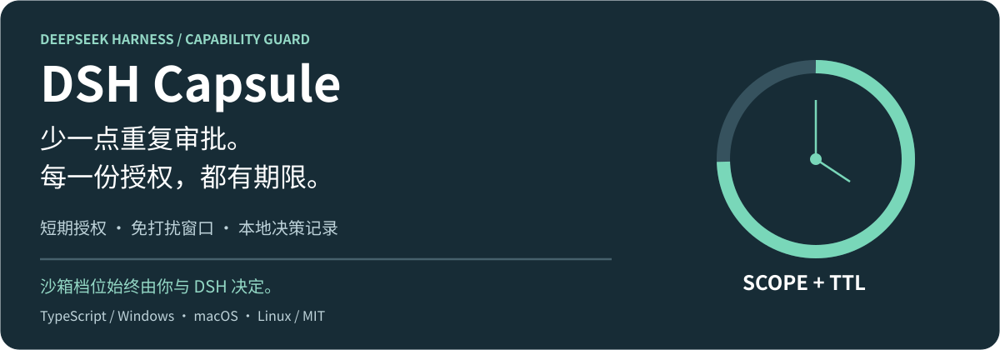
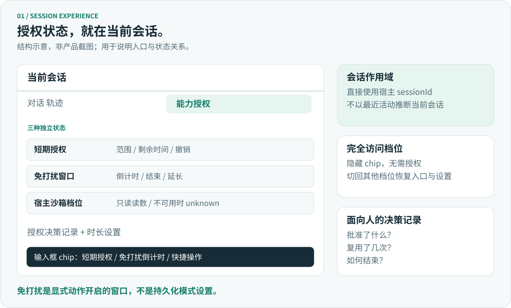
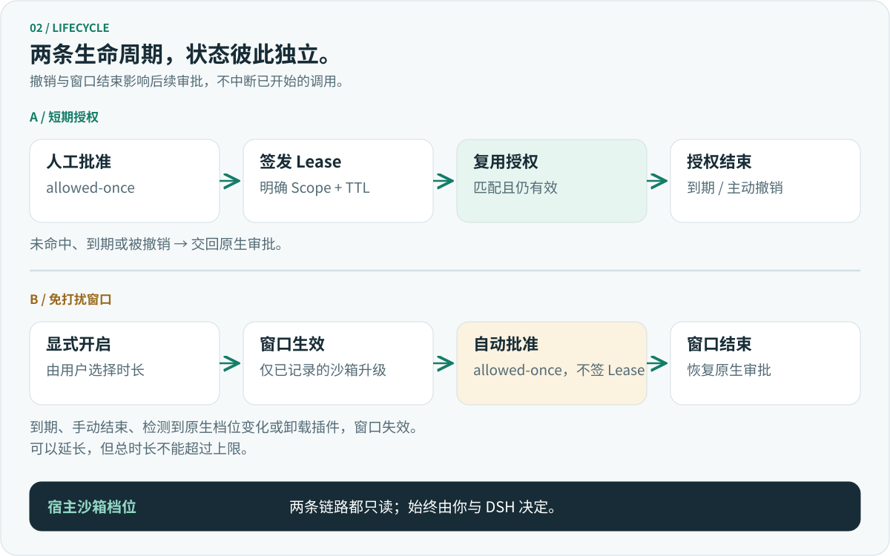
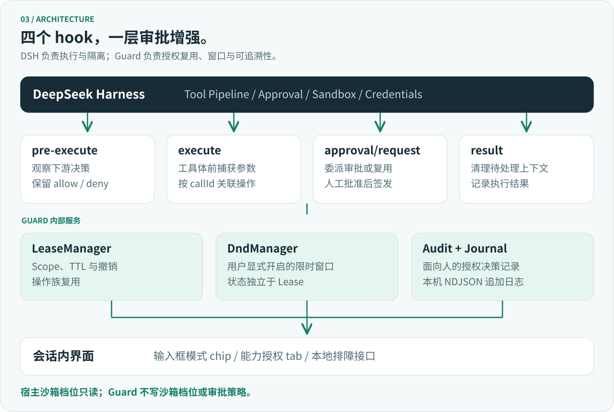

<p align="center">
  
</p>

<p align="center"><strong>简体中文</strong> · <a href="README.en.md">English</a></p>

<p align="center">
  <a href="https://github.com/whDonline/dsh-capsule/actions/workflows/ci.yml"></a>
  
  
  
  <a href="LICENSE"></a>
</p>

**把重复审批变成有期限、可撤销、可追溯的授权。**

DSH Capsule（Capability Guard）是 [DeepSeek Harness](https://github.com/deepseek-ai/deepseek-harness) 的纯 TypeScript 插件。在已有工具触发 DSH 原生审批时，它提供短期授权复用；你也可以显式开启免打扰窗口，让当前会话在有限时间内自动通过沙箱升级审批。已有工具无需为 Guard 改写代码。

**Guard 始终不改写会话沙箱档位。** 它处理的是审批，沙箱、审批策略与凭证仍由 DSH 原生机制负责。

> [!NOTE]
> 当前为 **Developer Preview**。仓库配置了 Windows / macOS / Linux 构建与测试矩阵，并有真实 Cordis 接线和权限生命周期测试。DSH 升级后仍需重新验证集成，不能把 CI 等同于所有平台上的 DSH 真机兼容承诺。

<p align="center">
  <a href="#快速开始">快速开始</a> · <a href="#日常使用">日常使用</a> · <a href="#授权如何工作">授权机制</a> · <a href="#配置">配置</a> · <a href="#安全边界">安全边界</a> · <a href="#开发与贡献">参与贡献</a>
</p>

## 为什么使用它

Agent 在“修改 → 测试 → 检查”的循环中，往往会重复申请相近操作。每次点批准会打断工作，而会话级完全访问又可能超出你的意愿。Guard 为这段工作提供一个有时限的审批复用层：

- **短期授权**：人工批准后签发 Lease，记录范围与有效期；命中有效授权时减少重复询问。
- **免打扰窗口**：由你主动开启，窗口内自动批准本会话已记录的沙箱升级请求，可随时结束。
- **会话内治理**：输入框模式 chip 和「能力授权」tab 显示授权、倒计时、设置和决策记录。
- **本地可追溯**：记录批准、复用、到期与撤销；审计与授权记录默认追加保存在本机。

## 快速开始

### 1. 构建与验证

准备 Node.js **22**、pnpm **11.25.0**，以及可运行的 DSH 环境。pnpm 版本由根目录 `packageManager` 固定。

```bash
git clone https://github.com/whDonline/dsh-capsule.git
cd dsh-capsule
pnpm install --frozen-lockfile
pnpm build
pnpm test
```

### 2. 安装到 DSH profile

包中已声明 `dsh.bundle.patch` 与 Web 客户端入口，可把本地构建的 `adapter` 目录作为 profile bundle 安装。将下面的路径替换成你的绝对路径，`web` 替换成目标 profile。

```bash
dsh plugin --profile web add "/absolute/path/to/dsh-capsule/adapter"
dsh --profile web --dump-config
dsh web
```

Windows 路径示例：`D:/gitpro/dsh-capsule/adapter`。`--dump-config` 用于离线检查配置组合；启动命令应与你安装的 profile 对应。

### 3. 完成第一次授权

1. 在 DSH Web GUI 打开会话，确认输入框左侧出现 Guard 模式 chip。
2. 让 Agent 执行一个会触发原生审批的操作，核对范围与时长后批准。
3. 打开会话内第三个 tab「**能力授权**」，查看授权剩余时间与复用记录。
4. 撤销该会话授权，再次执行操作，确认恢复原生审批。

处于 DSH **完全访问**档位时，chip 隐藏，tab 显示「完全访问档位：无需授权」。切回其他档位后入口恢复，用户设置保留。

> [!IMPORTANT]
> 修改宿主端插件代码并重新构建后，必须**重启 DSH**。profile 配置 HMR 不会重新加载已经装载的宿主 JavaScript；涉及接口字段变化时尤其如此。

## 日常使用



**输入框模式 chip** 是快捷入口，可关闭授权复用、使用短期授权或开启免打扰。开启免打扰前会提示风险，窗口内显示倒计时，并提供结束、延长动作。

**「能力授权」tab** 是详情入口，包含本会话指标、授权决策记录、免打扰状态，以及用户开关、复用时长、免打扰默认时长。免打扰是一次动作产生的窗口，修改默认时长不会直接开启窗口。

界面把以下状态分别展示：

- **授权是否有效**：由 LeaseManager 判定；到期或撤销后不能继续复用。
- **免打扰是否有效**：由 DndManager 管理，不混入授权列表。
- **当前沙箱档位**：宿主只读读数，读不到显示 `unknown`。

结束免打扰与撤销授权是两个独立动作。若要停止这两条自动放行路径，需要分别结束窗口并撤销授权。

当前不注册全局侧栏面板或设置页入口；输入框 dock 提示条保留槽位但不渲染。独立 HTTP 页面仅用于排障。

## 授权如何工作



### 短期授权

原始 `allow` / `deny` 保持原语义。需要询问时，Guard 优先检查已有授权；未命中则委派 DSH 原生答话器，只有结果为 `allowed-once` 才签发 Lease。拒绝、取消或不可用均不签发。

Lease 以 **Session × Tool × Scope × TTL** 描述授权。默认精确 Scope 对工具名、canonical JSON 参数和目标沙箱档位生成 SHA-256；`justification` 不参与指纹，JSON 对象键顺序不影响结果。

**精确 Scope 与产品层的操作族复用是两层机制。** 当前短期授权还会记录命令前缀、对象、目录和工具等操作族，因此不能把 `exact-arguments` 理解为“所有自动放行都要求参数完全相同”：

- 命令前缀通常按程序与子命令匹配；通过前缀复用复合命令时，每个识别出的前缀都必须已有有效放行。
- 对象、目录等族可让参数变化后的相近操作复用人工批准；族与来源 Lease 关联，来源过期或被撤销后失效。
- 破坏性命令和高危子命令受到排除规则限制，不能通过族复用自动放行；**精确匹配的既有 Lease 仍是独立路径**。
- 当前实现也为部分非 shell、非破坏性工具建立工具族，范围不限于只读工具。具体识别与匹配规则见 [`families.ts`](adapter/src/capability/families.ts)，接入前应结合所装工具评估复用范围。

Lease 的过期在查询与校验时实时判断，不依赖后台定时器。撤销不会修改宿主档位，也不会中断已经开始执行的工具调用。

### 免打扰窗口

免打扰是用户显式开启的**限时完全访问审批放行层**。它只接管 Guard 在 `tools/execute` 记录过、会话与工具匹配、且带 `requestedMode` 的沙箱升级审批，返回 `allowed-once` 并记录 `DND_ALLOWED`。

窗口**不签发 Lease、不改沙箱档位、不改审批策略**。普通审批仍走原生流程；窗口外也恢复原生审批。到期、手动结束、检测到原生档位变化或插件卸载时窗口失效。延长后的总窗口时长不能超过 `maxTtlSeconds`，完全访问档位下不能开启。

> [!WARNING]
> 窗口内，符合条件的沙箱升级请求会自动获批，目标可能是完全访问。它不提供“某些路径永不放行”的保护。请只在信任当前会话工作内容时开启。

## 架构与 DSH 集成



Guard 作为独立 Cordis 插件横切 DSH 管线，不修改 DSH Core：

1. `tools/pre-execute`：先取得下游决策，只增强 `ask`，不覆盖 `deny`。
2. `tools/execute`：在工具体执行前拿到参数，计算 Scope，并按 `callId` 记录操作上下文。
3. `approval/request`：默认 `await next()`；符合复用或免打扰条件时才代答 `allowed-once`，人工批准后记录授权。
4. `tools/result`：清理待处理上下文并记录执行结果。

真实 DSH 的标准 profile 中，`pre-execute` 通常落到 `allow`；常见升级审批来自**工具体内部**。而审批载荷没有工具参数，这正是需要在 `tools/execute` 提前记录操作的原因。

详见[真实 DSH 集成基线](docs/集成基线-真实DSH行为.md)。升级 DSH 后请重跑该文档第 10 节检查清单；宿主 API 以当前安装版本的 TypeScript 类型与行为为准。

## 配置

把以下覆盖项放入目标 profile 的 `cordis.patch.yml`。按 `id` 覆盖时会替换整行 `config`，请重述需要保留的字段。

```yaml
- id: capability-guard
  name: '@dsh-capsule/adapter'
  config:
    defaultScope: exact-arguments
    defaultTtlSeconds: 300
    maxTtlSeconds: 1800
    modeEnabled: true
    reuseTtlSeconds: 1800
    dndDurationSeconds: 900
    persistAudit: true
    sweepIntervalMs: 30000
    console:
      enabled: true
      host: 127.0.0.1
      port: 8787
```

**时长分为两个层面。** 用户默认复用时长为 **1800 秒**，免打扰默认时长为 **900 秒**；`approval/request` 路径签发 Lease 使用 `reuseTtlSeconds`。`defaultTtlSeconds` 是底层策略默认 TTL：随包 bundle 配置为 **300 秒**，直接调用插件但未配置时为 **60 秒**，供 `pre-execute` 的策略解析使用。不要只修改这个值来调整用户复用时长。

- `maxTtlSeconds`：默认 **1800 秒**，时长必须为正整数且不超过上限；降低上限时应同步调整用户时长配置。
- `modeEnabled`：用户开关的启动值；运行期对应 `settings.enabled`，关闭后四个 hook 直接透传。
- `sweepIntervalMs`：默认 **30000 毫秒**，`0` 关闭；只改善免打扰状态与审计结算的及时性，不决定授权是否有效。
- `persistAudit` / `auditFile`：控制本地日志写入与路径，默认开启。
- `console`：默认开启并监听 `127.0.0.1:8787`，端口冲突时回退到随机端口，实际地址写入 stderr。

`exact-arguments` 是唯一允许的默认 Scope。`fields` 与 `tool` 只能按工具显式配置在 `rules` 中；`fields` 需要明确 `paths`，`tool` 的范围更宽。规则以精确工具名匹配，示例中的工具名必须替换为实际已装工具：

```yaml
    rules:
      - match: deploy.preview
        ttlSeconds: 120
        scope:
          mode: fields
          paths: [project, environment]
```

运行期设置在「能力授权」tab 修改，**不写回 profile**，重启后回到启动配置。部署级 `enabled` / `rules` 与用户 `settings.enabled` 是不同字段，HTTP 接口不能修改部署级开关或规则。

## 审计与本地接口

面向人的**授权决策记录**按“一条授权一份记录”汇总批准范围、复用次数与结束方式。原始 `TOOL_*` / `PASSTHROUGH_*` 事件供排障使用。“少点了几次批准”统计 Lease 复用次数，是便利性指标，不参与权限判断。

默认日志位置为 `<用户目录>/.dsh/capability-guard/audit.ndjson`：

- 以 NDJSON 追加事件与授权状态，启动时重放当前日志，并为每条 Lease 保留最后状态。
- 达到 **20 MiB** 后轮转为 `.1`，仅保留一代；这不是无限历史档案，内存审计缓冲区也有容量限制。
- 不保存完整工具参数；保存工具名、Scope 哈希和脱敏展示串，展示串仍可能包含路径等本机信息。
- 坏行跳过，写入失败不阻断审批，首次失败在 stderr 提示。`persistAudit: false` 可关闭持久化。
- 重放的授权仍需通过实时有效性校验；免打扰窗口与操作族内存索引不会重放。

独立排障入口默认为 `http://127.0.0.1:8787/`；Web GUI 优先使用同源 `/guard/` 路由。下面路径相对于这两个入口：

```text
GET   /api/snapshot      会话、授权与免打扰快照
GET   /api/decisions     汇总后的授权决策记录
GET   /api/audit         原始审计事件
GET   /api/config        策略、用户设置与展示目录
PATCH /api/config        运行期策略与 settings 更新
POST  /api/revoke        { sessionId }：撤销会话全部有效授权
POST  /api/dnd           { sessionId, ttlSeconds }：开启窗口
POST  /api/dnd/stop      { sessionId }：结束窗口
POST  /api/dnd/extend    { sessionId, addSeconds }：延长窗口
```

写请求要求 `x-dsh-guard` 自定义头和 `Content-Type: application/json`，并检查来源；跨源仅接受 loopback 来源。`PATCH /api/config` 可更新策略的 `defaultScope` / `defaultTtlSeconds` / `maxTtlSeconds`，以及嵌套的 `settings.enabled` / `reuseTtlSeconds` / `dndDurationSeconds`。

> [!WARNING]
> **治理接口是本机 loopback 上的无鉴权面。** 能开启免打扰就意味着能在窗口内自动批准沙箱升级（限时完全访问）；CORS 与自定义请求头不构成本机进程身份认证。若不信任本机进程，请设置 `console.enabled: false`。

## 安全边界

- Guard 不覆盖 DSH 原始拒绝，也不绕过后续原生 guard 或 `approvalPolicy: never`。
- 无可信 Session 身份不签发匿名或全局 Lease；不为子 session 签发 Lease，也不提供跨 session 授权继承。
- Scope、TTL 或上下文无法验证时，不签发或不复用，保留原生审批语义。
- Guard 不调用 `setSandboxMode`、`permissionPresets.set` 或 `approval.setPolicy`。
- 这是一层审批增强，**不是恶意插件隔离边界**。其他可信进程内插件可以认领审批瀑布或修改原生权限状态。
- Guard 不提供 OS / 容器 / 网络隔离，也不保证第三方插件看不到凭证。凭证与隔离应由 DSH 原生能力或外部机制负责。

当前交付范围为短期授权、免打扰、决策记录和治理界面。旧 Python / Docker 隔离运行时、凭证代理、Managed SDK，以及“提升会话沙箱档位 + TTL 回滚”链路均已移除。

## 开发与贡献

```bash
pnpm build
pnpm test

# 启动带示例数据的独立治理页：http://127.0.0.1:8799/
node scripts/smoke-console.mjs

# 重新生成 README 的中英双语 SVG 配图
node scripts/generate-readme-assets.mjs
```

冒烟页面使用示例数据，不代表真实 DSH 会话。仓库布局：

```text
adapter/
├── client.js                # 输入框 chip 与会话内 tab
├── cordis.patch.yml         # DSH bundle 默认配置
└── src/
    ├── index.ts             # 插件装配、宿主只读适配器
    ├── capability/          # 四个 hook、Scope、Lease、操作族、免打扰
    ├── audit/               # 决策目录、审计服务、本地日志
    ├── console/             # 决策投影、会话视图与 HTTP 接口
    └── integration/         # 真实 Cordis 接线与生命周期测试
assets/readme/               # 可维护的双语 SVG 示意图，非截图
docs/                        # 技术规格与 DSH 集成基线
```

欢迎通过 [Issues](https://github.com/whDonline/dsh-capsule/issues) 提交可复现问题，或通过 Pull Request 改进实现与文档。涉及审批或授权的改动，请先阅读 [AGENTS.md](AGENTS.md)、[技术规格](docs/DSH_Capability_Guard_基于现有版本重构技术规格.md)与[集成基线](docs/集成基线-真实DSH行为.md)，以最新项目决策为准。

安全相关改动需要负向测试；修改 hook、事件顺序或宿主服务访问方式，必须同时覆盖真实 Cordis 集成测试。重点关注拒绝不被覆盖、会话隔离、并发 `callId`、过期撤销、取消清理与审计脱敏。

## 许可证

[MIT License](LICENSE)。
