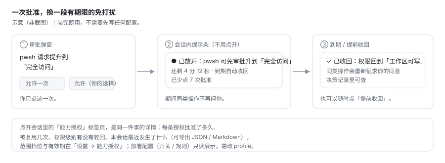

<p align="center">
  <b>DSH Capsule · Capability Guard</b>
</p>

<p align="center">
  <a href="README.md"><b>简体中文</b></a> · <a href="README.en.md">English</a>
</p>

<p align="center">
  
  
  
  
  
  
</p>

<p align="center">
  <b>批准一次，换一段有期限的授权；或者开一个「限时完全访问」窗口——到期自动收回，随时能提前收回，全程有记录。</b>
</p>

<p align="center">
  DSH Capsule 是面向 <a href="https://github.com/deepseek-ai/deepseek-harness">DeepSeek Harness</a> 的 <b>Capability Guard</b>：<br/>
  把 DSH 的「每次都要问」变成「有界、可复用、可撤销、可审计」的短期授权。
</p>

<p align="center">
  
</p>

**30 秒看懂**：装完即用、不用先写配置。Agent 反复要求同一类提权时，你批准一次，接下来一段时间它不再问你；
提示条一直告诉你「放开了什么、还剩多久、到期会怎样」，时间一到自动收回；想提前收回点一下就行。

> [!IMPORTANT]
> **项目定位已经变化。** 当前仓库是纯 TypeScript 的 Capability Guard，不再包含旧版 Python / Docker / Unix Domain Socket 隔离 Runtime。本文只描述当前代码真实存在的能力。2026-10-30 按项目决策移除凭证代理、命令凭证绑定及 Managed SDK/示例，当前聚焦通用短期授权。

> [!WARNING]
> **Developer Preview。** 核心链路（Lease、免打扰窗口、Audit、Console）已在仓库实现，有**真 cordis 集成测试**守护 hook 接线与完整权限生命周期，并已在本机 desktop profile 中实跑。
>
> DSH 本身仍在快速迭代：本仓库与本机安装版源码的核对结论记录在 `docs/集成基线-真实DSH行为.md`，**升级 DSH 后请重跑该文档第 10 节的检查清单**。

---

## 为什么需要它？

DSH 原生的权限体系有两层，中间是空的：

| DSH 原生 | 粒度 | 代价 |
|---|---|---|
| `permission-presets`（会话级沙箱 + 审批组合） | 一次生效、覆盖面广 | 粗：一放开就是整个会话 |
| `allowed-once`（单次审批） | 精确到这一次调用 | 细但每次都要问 |

缺的那一层是：**「这个 Session 内、这个工具、这类操作，在一段时间内已经批过了」**——既有界、又能复用、还能撤销与审计。

它能帮到的具体场景（也是它唯一值得装的理由）：

- 让 Agent 连续跑十几分钟的重构 / 测试循环，而你不想每 30 秒点一次「允许一次」；
- 需要临时写工作区外的东西（跑脚本、生成产物），但又不想把整个会话永久放开；
- 事后要回答「刚才那半小时，究竟是谁把权限放宽到哪一档、什么时候收回的」。

它能帮不到的（请务必看清）：

- **不是安全沙箱**：它不放宽、也不收紧 DSH 本身的进程隔离能力；需要强隔离请用 DSH 原生 Sandbox；
- **不能阻止其他插件**：`approval/request` 是开放瀑布，任何插件都能抢先认领或直接改会话权限；
- **不做凭证代理**（2026-10-30 已按项目决策移除），凭证交给 DSH 原生。

DSH Capsule 补的就是中间那一层：

| 问题 | DSH Capsule 的处理方式 |
|---|---|
| 同一个安全操作反复弹审批 | `allowed-once` 后签发短期 Lease，在相同 Scope + Session 内复用 |
| 授权范围太宽 | Lease 绑定 `Session × Tool × Scope × TTL` |
| 授权无法自动收回 | TTL 到期后恢复询问；Guard **从不改写**会话沙箱档位 |
| 发生了什么难以追踪 | 授权决策记录（谁批的 / 复用几次 / 怎么结束）+ 只读治理台 |
| 安全失败被静默放行 | 关键路径统一 **Fail Closed** |

一句话理解：

> **把一次明确批准变成有 Session、Scope 与 TTL 边界的短期授权。**

---

## 通用短期授权

### Universal Mode — 已有插件零改造获得短期授权

Guard 工作在 DSH 原生工具管线的**四个** hook 上（`tools/pre-execute` / `tools/execute` / `approval/request` / `tools/result`），原始语义保持不变：

- 原始 `deny`：始终保持 `deny`，Lease **不能覆盖拒绝**；
- 原始 `allow`：直接透传，Guard 不制造新的 Approval；
- 原始 `ask`：先查找匹配 Lease；命中则临时 `allow`，否则继续 `ask`；
- 用户返回 `allowed-once` 后，Guard 才签发带 Scope 与 TTL 的 Lease；
- `rejected` / `cancelled` / `unavailable` 均不签发。

> **沙箱升级是真实审批的入口，但 Guard 只做「这一次要不要问你」。** 它经过了与本机安装版 DSH 源码的逐行核对（结论见 `docs/集成基线-真实DSH行为.md`）：
>
> DSH 的 `tools/pre-execute` **落底决策就是 `allow`**，标准 profile 下没有任何随产品交付的监听器会返回 `ask`。真实审批来自 pwsh/bash/fs **工具体内部**的 `approveEscalation → ctx.approval.request(...)`（例如文件写入越出工作区时，模型带 `sandbox_permissions` + `justification` 重试）。
>
> 因此 Guard 的接入点是：在 `tools/execute`（工具体之前、参数仍可用）记录**这一次是什么操作**——工具名 + 参数（去掉模型自由文本）+ 目标档位；用户批准一次后签发一条 `universal` 操作授权。之后同一条操作再出现时，Guard 在 `approval/request` 上代答 `allowed-once`，DSH 仍按**单次升级**执行这次调用，**会话档位保持你设定的值**。
>
> 到期或撤销后，下一次同类操作重新问你。2026-11-01 起移除了旧的「提升会话档位 + TTL 回滚」链路：Guard 不再调用 `setSandboxMode`，也就不存在覆盖用户档位的问题。

这意味着 Universal Mode 的价值是**减少重复审批，同时保持 DSH 原有权限语义不变**。

<p align="center">
  
</p>

## 整体架构

Guard 接在 DSH 原生工具与审批管线上，保持原有审批与沙箱职责。

- UniversalGate：四个 hook，关联 callId、观察审批、签发与复用 Lease。
- ScopeResolver / PolicyResolver：确定性范围解析与 TTL 配置。
- LeaseManager / MemoryLeaseStore：Session 绑定、有效期与撤销。
- DndManager：免打扰窗口（限时完全访问的审批放行层）——独立的窗口状态，不写档位、不签 Lease。
- AuditService / GovernanceConsole：脱敏审计、授权剩余时间与运行期策略。

### 与 DSH 原生机制的边界

DSH Capsule **不是第二套 Harness**。它有意复用 DSH 已有机制：

- Approval 仍由 DSH 原生 `approval/request` Answerer 决定（Guard 只观察结果，**从不合成**）；
- Tool 最终是否允许执行仍受 DSH 其他 Gate / Guard 约束；
- 凭证管理仍由 DSH 原生服务或相关工具负责，Guard 不解析或注入凭证；
- 进程 / 文件 / 网络隔离仍由 DSH Sandbox 或外部安全机制负责；
- 沙箱档位仍完全由 DSH 的会话状态承载，Guard **只读不改写**（没有 `setSandboxMode` 调用）。

Guard 只新增一件事：**把一次明确的授权变成受 Scope、Session 与 TTL 约束的短期 Capability。**

---

## Capability Lease

一份 Lease 的核心身份不是“这个插件被允许了”，而是：

```text
Session × Tool × Scope × TTL
```

默认 Scope 按工具名与 canonical JSON 参数（去掉 `justification`）+ 目标沙箱档位生成 SHA-256：同一条命令「升到工作区可写」与「升到完全访问」是两条不同的操作。

### Lease 生命周期

```text
ASK
 └─ allowed-once
      └─ ISSUE ────────┐
                       │
                  ACTIVE
                   ├─ match → REUSE
                   ├─ TTL   → EXPIRED
                   └─ revoke→ REVOKED
```

- TTL 在 `find` / `validate` 时通过当前时间实时判断，正确性不依赖后台定时器；
- Lease 始终绑定 Session；缺少可信 `agent.id` 时不会创建匿名 / 全局 Lease；
- `revoke(leaseId)` 可撤销单条 Lease；
- `revokeSession(sessionId)` 可一次撤销整个 Session 的 Lease；
- 当前默认存储是 `MemoryLeaseStore`，重启后不会保留。

---

## Scope：决定“授权可以复用到哪里”

### `exact-arguments` — 默认

默认 Scope：

```text
SHA-256(toolName + canonical JSON(arguments 去掉 justification) + 目标沙箱档位)
```

只有「同一条操作」才复用：参数逐字节一致、且目标档位相同。它是 Universal Mode 最保守的零配置策略。

> 目标档位进入指纹：批准「升到工作区可写」不会让「升到完全访问」免问。
> `justification` 是模型每次现写的理由，**刻意不参与哈希**（否则措辞一变授权立即失效，
> 等于把安全边界建立在模型输出上）；它只用于给人看的展示。

### `fields` — 显式放宽

只把指定字段纳入 Scope。例如只按 `repo` 与 `branch` 授权，其他参数变化不会重新 Ask。
它必须按工具显式配置 `paths`，不能作为默认值。

### `tool` — 最宽

同一 Session 内只按 Tool Name 复用。它必须显式配置，不能成为默认行为。

## 界面：一眼、详情、配置

> 顶部那张图是**结构示意**，不是截图；下面描述的是真实槽位与真实行为。

治理界面按「先会话、后全局」组织；前两个入口都挂在**会话作用域**上，组件直接拿到宿主传入的 `sessionId`，
因此显示的一定是当前会话：

1. **【挡位】输入框工具栏的授权挡位控件**：`conversation.input.left`，紧挨 DSH 原生沙箱挡位（28px 按钮 + 原生 Menu）。
   三选一：**授权关闭 / 短期授权 / 免打扰（限时完全访问）**。免打扰开启前有风险确认，窗口内显示倒计时，
   可一键结束或延长；
2. **【详情】会话内「能力授权」标签页**：排在 对话 / 轨迹 之后的第三个 tab（`conversation.view`，order 20），
   包含指标、免打扰卡片（剩余时间 / 已自动放行记录 / 结束 / 延长）、两档时长设置与本会话审计；
3. **【排障】独立只读页面**：`http://127.0.0.1:8787/`，用于没有 Web GUI 的组合或接口排障，
   不再是面向使用者的入口；
4. **提示条**（`conversation.input.dock`）：代码与文案判定保留，当前不渲染（输入框 chip 已承担常驻提示）。

> 2026-11-01 更新：**免打扰不再是持久化"模式"，也不是设置项**——它是用户点击后才存在的一段窗口；
> `settings.section` 不再注册，用户配置只在会话内 tab 里。

### 免打扰窗口（限时完全访问）

一句话：**窗口内自动批准本会话的沙箱升级，不改沙箱挡位、不改审批策略、不签发 Lease。**

- 只接管"由 Guard 在 `tools/execute` 记录过、且带 `requestedMode`"的沙箱升级审批；普通审批仍然交回人类；
- 开启前必须确认（它等价于限时完全访问）；窗口显示倒计时，可**结束**、可**延长**（总时长不超过 `maxTtlSeconds`）；
- **完全访问挡位下不可开启**：该 preset 的审批策略是 `never`，没有可放行的审批；
- 到期 / 手动结束 / 用户切换原生挡位 / 插件卸载，窗口立即失效（切回原挡位也不会复活）；
- 每一次自动放行都记 `DND_ALLOWED`（工具、目标挡位、脱敏展示），关闭记 `DND_CLOSED`；不再用"记账 Lease"伪装。

不同当前挡位下的实际效果：

| 当前挡位 | 开启免打扰后的实际效果 |
|---|---|
| 仅可查看 | 写/改仍先被沙箱拒绝；模型带 `sandbox_permissions` 重试时不再弹窗，**这一次调用**按目标挡位执行（可以是工作区内，也可以是完全访问） |
| 工作区内修改 | 工作区内写本来就不问；越界操作走"拒绝 → 重试 → 单次升级"，升级审批被静默放行（目标只能是完全访问） |
| 完全访问 | **不可用**（没有审批可放行） |

> 免打扰是"限时信任窗口"，不是沙箱：窗口内 AI 仍受 DSH 沙箱与审批策略约束，但**每一次它主动申请的升级都会被批准**。
> 它不是路径级保护；需要"某些目录永远不放行"的能力尚未实现。

独立页面（与上面的会话内 tab 共用同一份数据源）的视图：

```text
当前会话       会话名 · 授权状态与剩余时间 · 当前沙箱档位（宿主读数） · 到期后会怎样 · 立即收回
全部会话       本进程内出现过的授权会话，点会话名可切换聚焦
审计           按 sessionId / toolName / decision 过滤的治理事件流
设置           默认范围挡位、TTL 上下限、只读部署规则、运行信息
```

「授权是否仍有效」与「当前沙箱档位」是页面上的两行**独立读数**：

| 授权状态 | 含义 |
|---|---|
| 生效中 / 即将到期 | 还有可复用的短期授权（≤30s 标为即将到期） |
| 已到期 / 已撤销 | 授权已失效，接下来的同类调用会重新询问 |

「沙箱档位」那一行只是宿主实时读数（例如「只读」）：它由 DSH 与你自己的设定决定，
**Guard 从不改写它**，因此页面上不存在「已提升 / 待回滚 / 已恢复」这类状态；读不到时显示「未知」，不做推断。

原始 `Lease ID`、`sessionId`、Scope 哈希与完整 Scope 串只出现在「技术详情」展开区；会话名来自 DSH 的会话标题（`ctx.sessionTitle`），读不到时降级为工作目录名或短 ID。

### 授权决策记录（而不是"事件流"）

会话内 tab 展示的是**一条授权一份记录**：批准了什么 → 被复用了多少次 → 怎么结束的。
`PASSTHROUGH_ALLOW` / `TOOL_SUCCESS` 这类属于遥测，默认折叠在「原始事件（排障用）」里——把几百条遥测摆在用户面前，
等于没有审计。

每条记录可以「复制 JSON / 复制 Markdown」，机器可读版本由 `GET /api/decisions` 提供（同一份数据）。

会话顶部还有一行**价值指标**：

```
本次会话：少点了 12 次批准 · 最长一次放开了 4 分 51 秒
```

`少点了 N 次批准` = 该会话里授权被复用的次数（每一次复用，都是你不用再点一次「允许一次」）。

### 旧的有界放宽接口已删除（2026-11-01）

`POST /api/window`、`action=restore-sandbox`、`SandboxGrantManager` 以及
`WINDOW_OPENED` / `SANDBOX_MODE_RAISED` / `SANDBOX_MODE_RESTORED` 审计决策都已随
「提升会话沙箱档位 + TTL 回滚」整条链路一起删除。Guard 现在**没有任何改写沙箱档位的入口**。
免打扰窗口（见下文）是唯一的"放宽"动作，且它也只放行审批、不改档位。

低频结算（`sweepIntervalMs`，默认 **30000**，`0` 表示关闭）：

```ts
{
  sweepIntervalMs: 30000,   // 每 30s 检查一次免打扰窗口的到期与档位漂移
  console: { enabled: true, host: "127.0.0.1", port: 8787 }
}
```

> 定时器**不是安全机制**：窗口是否有效、授权是否有效都在读写时实时判定；关掉它只会让状态与审计更新晚一点。

配置（默认**已开启**；端口被占用时自动回退到系统分配的随机端口，实际地址写在 stderr 里）：

```ts
{
  console: {
    enabled: true,
    host: "127.0.0.1",
    port: 8787,
  }
}
```

只提供：

```text
GET   /                 前端页面（独立入口；支持 ?session=<id> 聚焦会话）
GET   /console.js       共享前端脚本（面板与独立页面复用）
GET   /api/snapshot     治理快照（会话视图 + 免打扰窗口 sessions[].dnd；可带 ?session=<id>）
GET   /api/audit        审计过滤查询（原始事件流，含 DND_ALLOWED / DND_OPENED 等决策）
GET   /api/decisions    授权决策记录（一条授权一份：批准/复用/结束方式；可带 sessionId/toolName/limit）
GET   /api/config       运行期策略 + 挡位目录 + 收缩动作可用性 + 结算节拍 + features.dndWindow
PATCH /api/config       写接口：defaultScope / defaultTtlSeconds / maxTtlSeconds / settings(enabled·reuseTtlSeconds·dndDurationSeconds)
POST  /api/revoke       收缩型动作：撤销本会话仍有效的全部授权（唯一动作）
POST  /api/dnd          开启免打扰窗口：{sessionId, ttlSeconds}（限时完全访问；窗口内自动批准沙箱升级）
POST  /api/dnd/stop     结束免打扰：{sessionId}（纯收缩）
POST  /api/dnd/extend   延长免打扰：{sessionId, addSeconds}（总窗口不超过 maxTtlSeconds）
```

此外，插件会尝试把同一组接口挂到 DSH Web 服务器上的**同源**前缀 `/guard/…`（`registerGuardWebRoutes`）。
同源入口可用时面板优先走它（无跨源请求）；不可用时回落到独立端口（Console 对 loopback 来源开放 CORS）。
`/guard/` 与独立端口**互为备份**，任一可用治理台就能工作。

### 范围挡位（默认匹配范围）

治理台里可选的挡位，同时也是 `rules[].scope.mode` 的取值：

| 挡位 | 复用范围 | 可否作为默认值 |
|---|---|---|
| `exact-arguments` | 工具名 + 参数（去 justification）+ 目标档位 | ✅（零配置默认，也是目前唯一可默认的挡位） |
| `fields` | 只按指定字段取键 | ❌ 必须按工具显式配置 `paths` |
| `tool` | 同一 Session 内该工具的全部调用 | ❌ 必须按工具显式配置 |

> `tool` 被刻意排除在默认值之外（规格第 7 条）：默认值决定了「任意一次批准能复用多大范围」，
> 不允许它悄悄变成整个工具。
>
> `fields` 同样不在默认值里（2026-10-31 起）：兜底路径是 `path` / `file_path`，而多数工具（如 `pwsh`）
> 的参数里并没有这两个字段；`ScopeResolver` 遇到缺失字段会 **Fail Closed 抛错**，Guard 因而不接管本次调用——
> 结果不是"复用键更窄"，而是**这条授权永远用不上、每次都要问**。它只能在 `rules[]` 里按工具配置明确的 `paths`。

### 治理台的写权限边界

- 策略写接口只能改 `defaultScope` / `defaultTtlSeconds` / `maxTtlSeconds`；
- `enabled` 与 `rules` **接口层不可写**（返回 400）——页面不能关掉 Guard，也不能凭空新增授权规则；
- 运行期改动**不落盘**：Guard 不改写 profile 的 `cordis.patch.yml`，重启后回到 profile 配置值；
- **收缩型动作**（`POST /api/revoke`）只有一个动作：撤销该会话仍有效的**全部授权**，
  并写 `LEASE_REVOKED` 审计。它不影响沙箱档位（那是用户自己的设置）。
- **用户显式发起的放宽是 `POST /api/dnd`（免打扰窗口，限时完全访问）**：窗口内只自动批准
  本会话带 `requestedMode` 的已记录沙箱升级；**不改沙箱挡位、不改审批策略、不签发 Lease**。
  约束：TTL ≤ `maxTtlSeconds`（不静默裁剪）、必须能解析到真实 Session、完全访问挡位下拒绝；
  到期 / 手动结束 / 原生挡位变化 / 插件卸载立即失效；`/api/dnd/stop` 纯收缩，`/api/dnd/extend`
  延长但总窗口不超过上限。每次放行写 `DND_ALLOWED`，不伪装成授权。
- 页面**不做审批**：免打扰只是在用户显式开启的窗口内代答 `allowed-once`；普通审批永远走 DSH 原生流程。

> **安全提示**：治理接口是本机 loopback 上的无鉴权面。"能开免打扰"就等于"窗口内能自动批准沙箱升级
> （限时完全访问）"。不信任本机进程时请把 `console.enabled` 设为 `false`。

安全属性：

- 默认仅监听 `127.0.0.1`；Host 头必须是 loopback（DNS rebinding 防护）；
- 跨源只回显 loopback 来源，非 loopback 来源直接 403；
- 写接口要求自定义头（`x-dsh-guard`）＋ `application/json`，靠浏览器预检挡住 CSRF；
- 响应使用 `no-store`、`nosniff` 与 CSP；前端所有动态数据通过 `textContent` 渲染；
- 只展示白名单投影，不包含 Credential、Authorization Header 或原始 Tool Arguments。

---

## 快速开始

### 环境要求

- Node.js `22`
- pnpm `11.25.0`（仓库 `packageManager` 已固定版本）
- Windows / macOS / Linux 均可运行核心 TypeScript 代码；CI 已配置三平台矩阵

> [!NOTE]
> `@dsh-capsule/adapter` 已声明 `dsh.bundle.patch`（见 `adapter/cordis.patch.yml`），可作为一个 profile bundle 层被 DSH 装载；
> 本机 desktop profile 已安装并实跑（hook 挂载、输入框挡位 chip / 能力授权 tab 均可用）。尚未发布到 npm registry，
> 也**没有**做过多平台真机验证——CI 只跑三平台构建与测试。

```bash
git clone <your-repository-url>
cd dsh-capsule

pnpm install --frozen-lockfile
pnpm build
pnpm test
```

Workspace：

```text
@dsh-capsule/adapter
```

### 接入 DSH profile

插件包的 `package.json` 声明了 bundle patch，因此用 DSH 自带的 profile 插件管理命令即可接入：

```bash
# 把本仓库的 adapter 作为一个 bundle 装进目标 profile（web / desktop / …）
dsh plugin --profile web add <本仓库 adapter 目录的绝对路径>

# 装载前先离线检查组合结果（不 boot、不执行任何插件代码）
dsh --profile web --dump-config

# 启动
dsh web
```

安装后 Guard 会注册四个观察型 hook，并默认打开治理台。开箱默认行为：

- 默认范围挡位 `exact-arguments`：批准一次只覆盖「同一条操作」（工具 + 参数 + 目标档位）；
- **不提供任何"提升沙箱档位"的配置**：每次升级仍由 DSH 决定，Guard 只在 TTL 内代答同一条操作，
  或在免打扰窗口内放行审批；
- 治理台监听 `127.0.0.1:8787`。

要按自己的偏好覆盖，在 profile 的 `cordis.patch.yml` 中按 `id` 覆盖该行（patch 会替换整行 config，请重述要保留的字段）：

```yaml
- id: capability-guard
  name: '@dsh-capsule/adapter'
  config:
    defaultTtlSeconds: 60
    maxTtlSeconds: 1800
    defaultScope: exact-arguments
    console: { enabled: true, host: 127.0.0.1, port: 8787 }
    rules:
      - match: deploy.preview
        ttlSeconds: 120
        scope: { mode: fields, paths: [project, environment] }
```

> 本仓库的 `adapter/cordis.patch.yml` 可用 `dsh --profile <name> --dump-config --patch <该文件路径>` 单独验证语法，无需真正安装。
>
> 改完插件代码后需要**重启 DSH**：profile 的 HMR 只重组配置，不会重新加载已装载模块的新一代 JavaScript。

### 默认策略

```ts
{
  enabled: true,
  defaultTtlSeconds: 60,
  maxTtlSeconds: 1800,
  defaultScope: "exact-arguments",
  rules: []
}
```

其中 `defaultScope`（默认范围挡位）与两个 TTL 可以在 DSH Web GUI 的治理台里运行期切换；
`enabled` 与 `rules` 属于部署配置，只能在 profile patch 里改。

### Tool 级规则

```ts
{
  enabled: true,
  defaultTtlSeconds: 60,
  maxTtlSeconds: 1800,
  defaultScope: "exact-arguments",
  rules: [
    {
      match: "deploy.preview",
      ttlSeconds: 120,
      scope: {
        mode: "fields",
        paths: ["project", "environment"]
      }
    },
    {
      match: "dangerous.admin",
      enabled: false
    }
  ]
}
```

当前 V1 的 `match` 是**精确 Tool Name 匹配**，不是 glob / regex。

---

## Fail-Closed 错误模型

关键安全失败使用结构化错误码，而不是静默降级：

```text
LEASE_REVOKED
LEASE_EXPIRED
LEASE_TTL_INVALID
LEASE_SCOPE_INVALID
LEASE_POLICY_INVALID
```

核心原则：

> **无法校验身份、Scope 或 TTL 时，不签发或复用 Lease，保留原生审批语义。**

审计里与授权生命周期相关的事件（其余是遥测与免打扰窗口事件）：

```text
ASK                   Guard 决定询问（下游 ask 且没有可复用授权）
LEASE_ISSUED          人工批准后签发短期授权
LEASE_REUSED          命中已有授权 / 族放行（记「凭族放行：…」）
LEASE_REVOKED         用户提前收回
APPROVAL_REJECTED     人工拒绝（或下游返回非 allowed-once）
DND_OPENED / DND_ALLOWED / DND_EXTENDED / DND_CLOSED   免打扰窗口的开关与放行
```

---

## 安全边界与非目标

这是当前项目最重要的边界说明：

### Universal Mode 能承诺什么

- 为原本触发 `ask` 的 Tool（包括 DSH 的沙箱升级审批）增加短期 Lease；
- Session / Tool / Scope / TTL 绑定；
- 过期、撤销、复用与审计；
- 免打扰窗口内的自动放行（限时完全访问），到期/结束立即恢复询问；
- 不覆盖 DSH 原始 `deny`；
- 不修改已有 Tool 代码即可接入。

### Universal Mode **不能**承诺什么

- 不能保证任意第三方插件看不到 Credential；
- 不能阻止插件自己发网络请求；
- 不提供进程、容器、VM 或 microVM 级恶意代码隔离；
- **不能阻止其他插件认领 `approval/request`**：这是 DSH 的开放瀑布事件，"谁认领谁说了算"。任何插件都可以零交互返回 `allowed-once`，也可以抢先认领从而遮蔽 Guard 的观察位置。这是 DSH 事件模型的固有性质，不属于本插件能防御的范围；
- **不能阻止其他插件直接改写会话权限状态**：`setSandboxMode(session, mode)`、`ctx.permissionPresets.set(...)`、`ctx.approval.setPolicy(...)` 在 DSH 中都是公开 API；Guard 自己的选择是**一个都不调用**，只观察审批。

## 当前状态

| 能力 | 状态 |
|---|---|
| Universal Lease Gate（四 hook） | ✅ 已实现 |
| Session / Scope / TTL / Revoke | ✅ 已实现 |
| 免打扰窗口（限时完全访问的审批放行层） | ✅ 已实现（`capability/dnd.ts`） |
| 真 cordis 集成测试（真实 `Context` / `waterfall` / `emit`） | ✅ 已实现 |
| 权限生命周期端到端集成测试（ask→签发→复用→过期/撤销） | ✅ 已实现（`integration/permission-lifecycle.test.ts`） |
| DSH 行为基线核实（逐行核对已安装版本源码） | ✅ 已完成（`docs/集成基线-真实DSH行为.md`） |
| 治理台：会话视图 / 授权剩余时间 / 宿主档位读数 / 审计 / 范围挡位 | ✅ 已实现（Web GUI 面板 + 独立页面 + `/guard/` 同源路由） |
| 治理台收缩型动作：立即收回（只收缩，带审计） | ✅ 已实现（`POST /api/revoke`） |
| 免打扰窗口结算（`sweepIntervalMs`，默认 30s，可关） | ✅ 已实现（非安全机制，只负责及时性） |
| Secret-safe Audit | ✅ 已实现 |
| Ubuntu / Windows / macOS CI workflow | ✅ 已配置 |
| 在真实 profile 中安装并实跑（hook 挂载 + 治理台 + 面板注册） | ✅ 已完成（本机 desktop profile） |
| 可直接安装的公开 DSH Release Package（`dsh.bundle.patch`） | ✅ 已具备（`dsh.bundle.patch` + `dsh.client`） |
| Durable Lease Store | 🗺️ Roadmap |

DeepSeek Harness 本身也处于 Developer Preview 并快速迭代，因此正式接入时应始终以当前安装版本的 TypeScript 类型为准，而不是把事件签名硬编码为长期兼容承诺。**升级 DSH 后请重跑 `docs/集成基线-真实DSH行为.md` 第 10 节的检查清单。**

---

## 仓库结构

```text
adapter/
├── client.js                 # DSH 客户端半边：模式 chip + 会话内「能力授权」tab
├── cordis.patch.yml          # 插件默认配置（默认不写任何沙箱档位）
└── src/
    ├── index.ts              # 插件装配与宿主适配（档位只读读取 / 免打扰结算节拍）
    ├── capability/           # 四个 hook、Scope、Lease、免打扰窗口
    ├── integration/          # 真 cordis 接线与权限生命周期测试
    ├── audit/                # 脱敏审计
    └── console/              # 会话视图 / 决策记录 / HTTP 接口 / 撤销动作 / 会话名解析
scripts/smoke-console.mjs     # 治理台冒烟脚本（示例数据 + 真实撤销动作）
.github/workflows/ci.yml      # Windows / macOS / Linux 构建与测试
```

---

## 设计原则

**Preserve DSH semantics.** Guard 只增强 `ask`，不覆盖 `deny`，不重新发明 Approval。

**Short-lived authority.** 权限必须有明确 Session、Scope 与 TTL，而不是永久授权。

**Deterministic scope.** 安全边界来自确定性规则，不让 LLM 猜授权范围。

**Fail closed.** 身份、Scope 或 TTL 无法验证时不签发或复用授权。

**Secret-safe observability.** Audit 与 Console 只保留治理所需的白名单字段。

**Small trusted core.** 核心只负责短期授权生命周期，不代管凭证或执行外部业务。

---

## FAQ

### 这和 RBAC 有什么区别？

RBAC 更适合回答“这个角色通常拥有什么权限”。Capability Lease 回答的是：**这个 Session 在当前 TTL 内，是否允许这个 Tool 对这个 Scope 执行当前操作。** 它更适合 Agent 的动态、短时工作流。

### Universal Mode 能保护所有第三方插件吗？

它可以零改造地为**原本会触发 DSH `ask`** 的 Tool，以及**沙箱升级**，增加短期 Lease；但不能阻止其他插件认领 `approval/request`，也不能阻止插件访问其进程本身已经拥有的资源。

### 为什么默认 Scope 是 `exact-arguments`？

因为零配置情况下无法可靠猜测某个第三方 Tool 的业务资源语义。默认只复用完全相同的参数，宁可多问一次，也不扩大授权面。

**但要说实话**：零配置的 `exact-arguments` 只覆盖「同一条操作」——LLM 换个路径、换个命令就要再问一次。
真正省事的是一次性开一个免打扰窗口（限时完全访问）；`fields` 则是按业务字段放宽，需要显式配置——**收益来自显式选择，而不是默认值**。

### 同一条操作怎么判定？

工具名 + 参数（`justification` 不参与，因为它每次都由模型现写）+ 目标沙箱档位，取 SHA-256。
因此「同一条命令升到工作区可写」与「升到完全访问」是两条操作；换一条命令、换一个路径都算新操作。
命令行里的凭据形状（`--with-token xxx`、`ghp_…`、`Bearer …`）在展示前会被脱敏，审计里不出现原文。

### Guard 会不会改我的沙箱档位？

不会。2026-11-01 起「提升会话档位 + TTL 回滚」整条链路已删除，Guard 没有 `setSandboxMode` 调用，
治理台里的「沙箱档位」只是宿主实时读数。批准一次的效果是：**这一次 DSH 的升级审批被代答 `allowed-once`**，
以及「同一条操作在 TTL 内不再问」；档位始终由你和 DSH 决定。

### 支持 Windows / macOS / Linux 吗？

当前主链路是纯 TypeScript，没有 Python / Docker / Unix Domain Socket 依赖；仓库 CI 也配置了三平台矩阵。真实 DSH 集成仍需按具体 DSH 版本做兼容性验证。

---

## Roadmap

近期聚焦授权范围与状态展示、生命周期异常恢复、审计与 DSH 版本兼容性。新增撤销界面、续期或更细范围前，需先更新规格并验证宿主执行边界；当前不承诺这些功能已经实现。

---

## Contributing

安全基础设施最需要的是**负向测试与清晰边界**。欢迎贡献：

- Lease / Scope / Session 隔离测试；
- 并发 `callId`、取消与生命周期 Race 测试；
- 审计脱敏回归测试；
- DSH 版本兼容性验证；
- 文档、Demo 与可复现集成样例。

如果一个改动会扩大可信计算面、引入凭证执行链路，或试图绕开 DSH 原生 Approval / Sandbox，请先讨论设计再实现。

---

## License

MIT License. See [`LICENSE`](LICENSE).

<p align="center">
  <b>DSH Capsule</b><br/>
  <sub>Short-lived authorization · Time-boxed DND · Fail-closed by design</sub>
</p>
